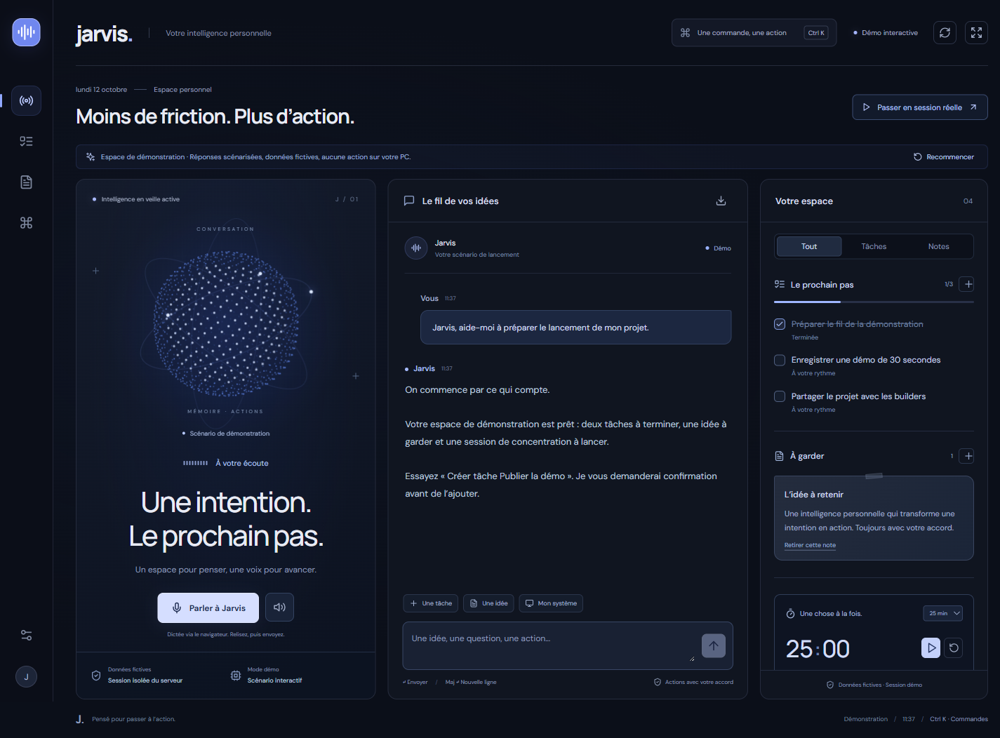

# JarvisVibeCoding — assistant personnel local

Un cockpit unique pour votre assistant : conversation, tâches, notes et état du PC, avec confirmation obligatoire avant chaque action.



**Démo scénarisée en ligne** : <https://mazounirayan.github.io/JarvisVibeCoding/>
Aucune IA ni serveur derrière : tout se joue dans votre navigateur, avec des réponses scénarisées et des données fictives. La même démo tourne en local avec `npm run dev:client` puis <http://localhost:5173/?demo=1>. Voir aussi la [vidéo de démonstration (23 s)](docs/jarvis-demo.mp4) et la [capture mobile](docs/jarvis-v3-mobile.png).

## Ce que fait réellement l’assistant

- **Conversation** avec le modèle que vous configurez : Ollama local ou Gemini (clé conservée côté serveur).
- **Tâches et notes** : création, consultation, clôture et retrait — chaque modification passe par votre confirmation explicite.
- **État du PC** : informations réelles du système (plateforme, mémoire, processeur, durée d’activité).
- **Recherche de fichiers** : noms seulement, dans les dossiers que vous autorisez, parcours borné, contenus jamais lus.
- **Applications** : lancement des exécutables de votre liste blanche, sans shell libre ni arguments libres.
- **n8n** : un seul webhook configurable, déclenché après confirmation ([WEBHOOK.md](WEBHOOK.md)).
- **Météo** : via le service public wttr.in, si un modèle est configuré (requête vers ce service).
- **Voix du navigateur** : dictée avec brouillon — envoi automatique après environ 1,5 s de silence ou sur « Valider la phrase », « Annuler » jette le brouillon ; mode mains libres optionnel (« Jarvis », « Dis Jarvis ») ; lecture vocale des réponses.
- **Commandes locales sans modèle** : « Créer tâche … », « Afficher les tâches », « Note : … », « Afficher les notes », « État système », « Terminer tâche [id] », « Oublier note [id] », « Trouver fichier … », « Ouvrir [application] ».
- **Cockpit** : palette de commandes `Ctrl K`, minuteur de concentration, export Markdown, copie des messages, mode présentation (Échap pour quitter).

## Sécurité

- API locale qui écoute sur `127.0.0.1`, mono-utilisateur, sans comptes.
- Chaque action ayant un effet exige une **confirmation à jeton unique**, expirant en cinq minutes, non rejouable ; la proposition exacte est conservée côté serveur.
- Recherche confinée aux dossiers autorisés, applications en liste blanche, aucun shell arbitraire, aucune suppression de fichiers, aucun paiement.
- Les secrets restent dans `server/.env`, jamais dans le client.
- Détails complets : [SECURITY.md](SECURITY.md).

## Installation locale

Prérequis : Node.js ≥ 20 et npm.

```powershell
npm ci
npm run dev:server
```

Dans un second terminal, puis ouvrir <http://localhost:5173> :

```powershell
npm run dev:client
```

Choisir ensuite le fournisseur dans les réglages : un modèle Ollama déjà installé, ou une clé Gemini dans `server/.env` (créé par vos soins ; sur macOS/Linux, les commandes sont `npm ci` puis `npm run dev:server`). Les clés restent toujours côté serveur. Variables optionnelles : `OLLAMA_MODEL`, `GEMINI_API_KEY`, `GEMINI_MODEL`, et les permissions `JARVIS_ALLOWED_DIRS`, `JARVIS_APPS`, `N8N_WEBHOOK_URL` — toutes vides par défaut. `client/.env` peut contenir `VITE_API_URL`, vide pour le proxy de développement. Guide détaillé : [QUICKSTART.md](QUICKSTART.md).

Vérifier l’installation :

```sh
npm run typecheck
npm test
npm run build
```

## Limites assumées

- **Mono-utilisateur local** : l’API n’a pas d’authentification multi-utilisateurs. Ne pas l’exposer via tunnel ou conteneur public sans y ajouter authentification et autorisation.
- **Voix** : la reconnaissance vocale du navigateur peut envoyer l’audio à un service externe, même avec Ollama local ; la synthèse dépend des voix installées. Le texte reste toujours utilisable sans micro.
- **Fournisseurs non validés ici** : les tests automatisés simulent Ollama, Gemini et n8n ; aucune clé ni modèle réel n’a été activé sur le poste de préparation.
- **n8n** : une acceptation HTTP n’atteste pas la fin du workflow.
- **Démo en ligne** : les réponses sont scénarisées ; elle ne montre pas une conversation IA réelle.
- **Données** : conversations, notes et tâches sont conservées en JSON local, sans chiffrement applicatif ; protégez le dossier de données.

## Licence

Code sous [Apache License 2.0](LICENSE). Notices des dépendances et polices : [THIRD_PARTY_NOTICES.md](THIRD_PARTY_NOTICES.md).
